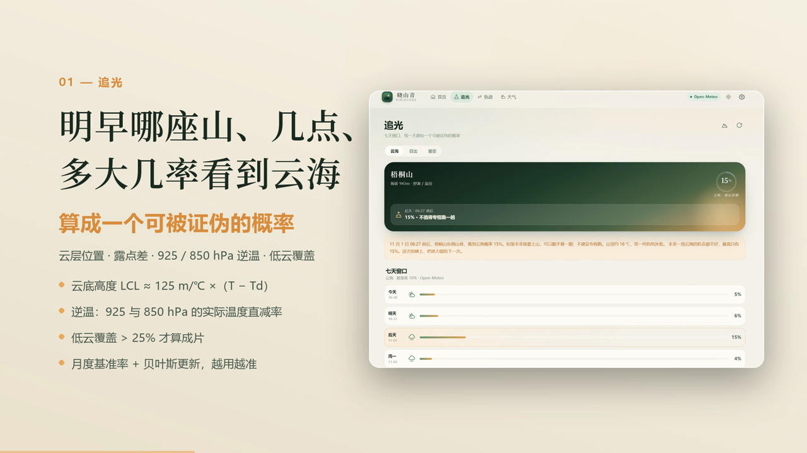
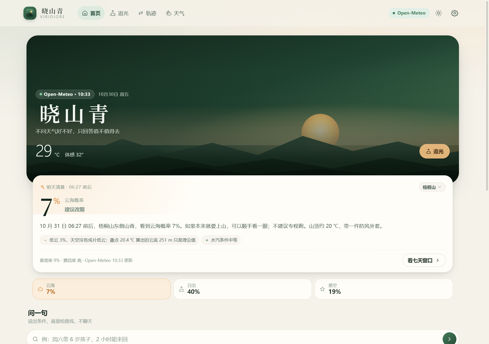
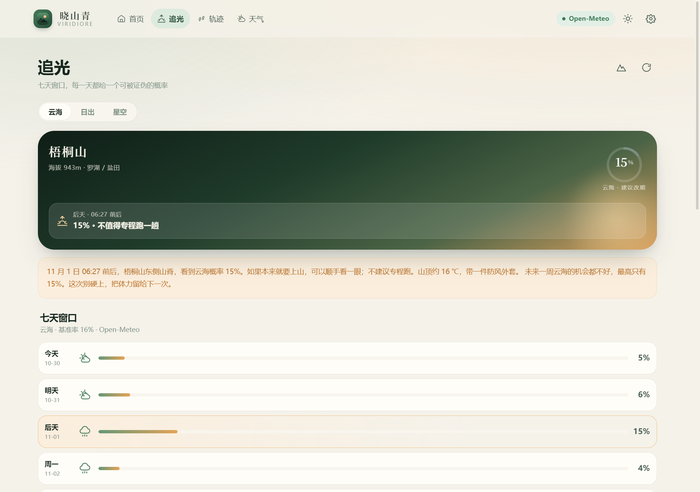
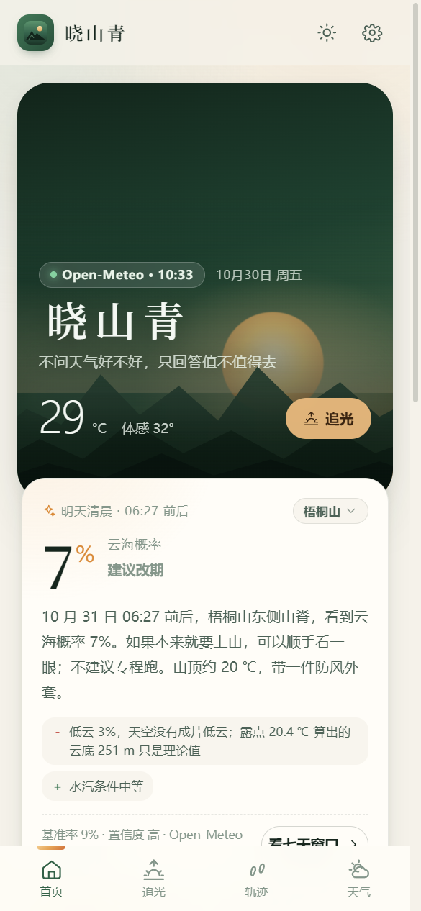
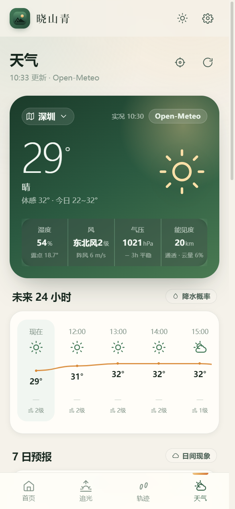

# 晓山青 Viridiore

一款为华南户外爱好者做的**追光工具**：告诉你明早几点、去哪座山、多大几率看到云海，并把走过的路变成一张能保存的卡片。

四端同源（浏览器 PWA / Windows / Android / iOS），离线可用。

  

<p align="center">
  
</p>

### 界面

<p align="center">
  
  
</p>

<p align="center">
  
  
</p>

<!-- SCORECARD:START -->
## 回测记分牌

> 真值 = ERA5 再分析；判的是「气象条件是否成立」，不是「有人看到」。本表由 `npm run ledger:scorecard` 从 `data/ledger.json` 自动生成。

| 指标 | 数值 |
| --- | --- |
| 已记录预测 | 2268 条 |
| 已对账 | 1224 条（7 天） |
| 待对账 | 1 天 |
| 命中率 | 30% |
| **Brier** | **0.235**（越低越好，0.25 = 永远说 50%） |
| 对账截至 | 2026-11-09 |

按提前量：

| 提前量 | 样本 | 平均预测 | 实际成立 | Brier |
| --- | --- | --- | --- | --- |
| 当天/次日 | 504 | 17% | 32% | 0.255 |
| 提前 2–3 天 | 396 | 18% | 32% | 0.264 |
| 提前 4–6 天 | 324 | 20% | 23% | 0.169 |

按模式：

| 模式 | 样本 | 平均预测 | 实际成立 | Brier |
| --- | --- | --- | --- | --- |
| 云海 | 408 | 14% | 9% | 0.096 |
| 日出 | 408 | 27% | 37% | 0.234 |
| 星空 | 408 | 12% | 43% | 0.377 |

<!-- SCORECARD:END -->

---

## 一、这个版本只做三件事

v2.0 之前它想做的事情太多：SOS、队友位置、气压计、装备清单、路书、AI 助手……十个功能没有一个是真正能用的。这个版本做了减法。

### 1. 追光 —— 唯一有差异化的功能

天气 App 满街都是，但"明早哪座山、几点、多大几率看到云海"没人做好。这一版把它做成了一个**可以被证伪的概率**，而不是一个 100 分制的评分。

模型不是拍脑袋的线性权重，而是从物理量出发：

| 判据 | 怎么算 | 为什么 |
| --- | --- | --- |
| 云层位置 | 抬升凝结高度 `LCL ≈ 125 m/℃ × (T − Td)` 得云底，加云层厚度得云顶，与山顶海拔比较 | 云海的定义是"云在你脚下"，这件事可以被算出来 |
| 露点差 | 直接用 API 给出的露点，算 `T − Td` | T−Td 是判断是否接近饱和的直接指标 |
| 逆温强度 | **925 hPa 与 850 hPa 的实际温度直减率**（`(T低 − T高) / Δz`），低于 6.5 ℃/km 即偏稳定，为负就是逆温 | 逆温层是云海存续的前提。不再是代理估算：温度随高度升高就是逆温，可以手算复核 |
| 低云覆盖率 | `cloud_cover_low` 层数据，> 25% 才算成片 | 散云不叫"海"。天空通透时算出的云顶再低也没有意义 |
| 风力 | 风速越大越容易把逆温层搅散 | 3 级以上明显减分 |
| 海拔 | 山越高越容易穿出云层 | 对 800 m 以上的峰给小幅加成 |
| 月度基准率 | 华南云海集中在 11—3 月 | 不问月份的模型都是耍流氓 |

输出结构是 `logit(P) = logit(月度基准率) + Σ 各项证据`，最后转回概率。v2.6 起在最后再加一层**回测拟合的保序校准** p = sigmoid(a·logit(p) + b)，系数来自 1,224 条 ERA5 对账（见 `data/calibration.json` 与 `scripts/forecast/calibrate.mjs`）。界面上同时展示**基准率**和**置信度**，并把每一项加减拉出来给人看——用户有权反驳。

**反馈校准**：用户每次上山后点一下「看到了 / 白跑一趟」，就是一条带标签的样本。样本用收缩估计（`n/(n+8)`）逐步修正概率，全部存在本机 IndexedDB，不上传、不需要账号。这是这个产品唯一的数据飞轮。

### 2. 轨迹

- GPS 记录走 Web Worker，距离用 haversine，爬升用三点滑动平均 + 2 m 阈值过滤抖动，路径按最大 400 点简化
- 后台计算，切页面不中断
- 导出 GPX
- **光之卡片**：Canvas 手绘 1080×1350 的图，带时间、海拔、坐标、当时的天气和一句话叙事，可保存、可系统分享

### 3. 天气

- **Open-Meteo**（ECMWF / GFS 数值模式）实时 / 24 小时 / 7 日预报，含 850 / 925 hPa 气压层
- 免费、无需注册、无需 Key，装完打开就是真实预报
- **"现在"取 15 分钟实况**，不是拿最近整点的预报值冒充。温度、湿度、体感、风、气压都是观测时次的插值场，界面右上角标出实况时刻，可以拿去和窗外对
- **24 小时温度曲线**按逐格数据点绘制，不是装饰图；每格另附降水概率与风力
- **空气质量按中国国标（HJ 633-2012）自算**：由 PM2.5、PM10、O₃、NO₂、SO₂、CO 六项浓度取分指数最大值，与国内天气 App 同口径；卡片里六项浓度和各自的分指数条全部摊开
- 可选接入和风天气，补上中国气象预警与官方 AQI
- **没有演示数据，也没有回退占位**：取数失败就显示"取数失败"并给重试按钮，不拿编造的天气充数
- 气象预警以横幅形式并入天气页（原先是独立页面，但预警只有被看见才有价值）

---

## 二、"AI"在哪

没有 AI 聊天框。聊天框是一个承诺，兑现不了就是负资产。

AI 以四层能力存在：

| 层 | 位置 | 做什么 | 用什么实现 |
| --- | --- | --- | --- |
| 预测层 | `src/services/chase.js` + `atmos.js` | 把气象量折算成概率 | 物理模型 + 贝叶斯更新，**不调模型** |
| 决策层 | `src/services/intent.js` | 把"周六带 6 岁孩子，2 小时能来回"解析成 `{时长<2h, 难度≤2, 亲子}`，返回 3 条路线 | 规则解析，20 行内可读、零延迟、离线可用 |
| 叙事层 | `src/services/narrative.js` | 轨迹 + 天气 + 时间 → 一句可转发的话 | 模板拼装，不臆断用户看到了什么 |
| 陪伴层 | `src/services/companion.js` | 每天一句可追溯到真实数据的话；保存轨迹后说「第 N 次上这座山」 | 模板 + 真实轨迹统计，**不调模型** |

决策层刻意挂在首页的输入框上，而不是一个独立页面——用户不会为了问一句话点开新页面，但会顺手打一行字。

叙事层不用大模型做主路径的理由：数据本来就是结构化的，模板的信息密度更高；山上没信号；**户外内容一旦编造，"记得住"就变成"不可信"**。

---

## 三、快速开始

```bash
npm install
npm run dev        # http://localhost:5173
npm run build      # 产出 dist/
npm run preview    # 预览构建产物
```

要求 Node 18+。

---

## 四、外部数据源

**默认不需要任何配置**。预报走 [Open-Meteo](https://open-meteo.com/)，免费、不用注册、没有 Key，唯一要求是能联网。此时「现在」是 ECMWF/GFS 模式插值，通常比气象站实测偏热、偏干。

和风天气是**可选增强**，但填了 Key 后它会成为**天气页的主显示源**：实况取国内站点观测（与手机自带天气同源），预报用中国区域预报；追光所需的高空层结仍从 Open-Meteo 的中国气象局 GRAPES 模式（`cma_grapes_global`）获取。想开的话：

**Key 和 Host 要一起填，只填 Key 用不了。**

2024 年之后注册的和风账号都会分配一个**专属 API Host**（形如 `https://abcdefg.re.qweatherapi.com`），旧公共域名 `devapi.qweather.com` 对新账号一律返回 `403 Invalid Host`。Host 在控制台「项目管理 → 打开项目」页顶部，复制过来时不用管有没有 `https://`，程序会自己补。

**方式 A：App 内填写（推荐）**
进入「设置 → 和风天气」，粘贴 Key 与 Host，点「测试连接」。两个值只保存在本机 `localStorage`，优先级最高，换机器才需要重填。

**方式 B：构建时注入**

```bash
cp .env.example .env
# 编辑 .env，填入 VITE_QWEATHER_KEY 与 VITE_QWEATHER_HOST
npm run build
```

> **安全提醒**：前端打包产物里的 Key 一定会被扒出来，**装到别人机器上的安装包尤其如此**——拿到 exe 的人解包就能看到。`.env` 已在 `.gitignore` 中，但真要分发，请到和风控制台设置**域名白名单**并开启**用量告警**，或者把请求转发到你自己的服务端。公开发布的安装包建议不内置 Key，让使用者自己填。

不填 Key 不影响追光和天气——追光的逆温判据本来就依赖 Open-Meteo 的气压层数据，和风给不了。

> 如果所在网络连不上 Open-Meteo，应用不会退化成假数据，而是显示"取数失败"和重试按钮。

---

## 五、打包成安装包

### Windows（本机可直接出包）

```bash
npm run desktop:build
```

产物在 `release/`：

- `XiaoShanQing-<version>-Setup-x64.exe` —— NSIS 安装包，中文界面、可选安装目录、桌面与开始菜单快捷方式
- `XiaoShanQing-<version>-x64.exe` —— 单文件绿色版，双击即用

> 构建脚本设了 `signAndEditExecutable: false`，改由 `scripts/after-pack.cjs` 在打包后直接调用 `rcedit-x64.exe` 写图标与版本信息。原因：electron-builder 内置流程要下载含 macOS 符号链接的 `winCodeSign` 资源包，在无符号链接权限的 Windows 上必然失败。这样改完无需网络镜像，纯离线可重复构建。

### Android

不想自己编译，可直接下载预编译 APK（debug 签名，安装前允许「未知来源」即可）：见 [Release v2.5.0-android](https://github.com/xxx1-sg/Viridiore/releases/tag/v2.5.0-android)。自己出包则需要装有 Android Studio 的机器：

> 仓库里提交的 `android/app/src/main/assets/public` 与 `ios/App/App/public` 只是旧构建快照。打包前务必先 `npm run mobile:sync`（已包含 `npm run build`），否则会把旧网页打进原生包。

```bash
npm run build
npx cap sync android
npx cap open android     # 用 Android Studio 打开
```

在 Android Studio 里 `Build → Generate Signed Bundle / APK`。定位权限已在 `android/app/src/main/AndroidManifest.xml` 声明。

### iOS

需要 macOS + Xcode：

```bash
npm run build
npx cap sync ios
npx cap open ios
```

在 Xcode 里设置 Team 与 Bundle Identifier，然后真机运行或 `Product → Archive`。`Info.plist` 里的定位用途描述已经写好，缺了会被审核拒绝。

### PWA

`npm run build` 后用任意静态服务器托管 `dist/`。`sw.js` 由 `scripts/generate-sw.mjs` 在构建后生成，策略是：

| 资源 | 策略 |
| --- | --- |
| 静态资源（JS/CSS/图标） | Cache First |
| 页面导航 | Network First，失败回落缓存 |
| 天气 API | Network First，5 秒超时回落最近一次结果 |

iOS 需要用 Safari「添加到主屏幕」，系统不提供 `beforeinstallprompt`。

---

## 六、目录结构

```
src/
├─ main.js                  入口：注册页面、启动、注册 SW
├─ router.js                hash 路由（file:// 与 app:// 下都可靠）
├─ state.js                 全局状态：位置、天气、当前山峰
├─ config.js                运行时配置（localStorage 覆盖 env 覆盖默认值）
├─ styles/
│  ├─ tokens.css            设计令牌：苔藓绿 × 破晓琥珀，含暗色主题
│  ├─ base.css              重置与启动动画
│  ├─ components.css        卡片、按钮、表单、弹层、Toast
│  ├─ layout.css            顶栏、底栏、栅格、断点
│  └─ pages.css             页面级样式
├─ core/                    dom / icons / db / store / format / modal / toast / theme
├─ data/mountains.js        12 座山 + 15 个城市
├─ services/
│  ├─ atmos.js              大气物理量：露点、LCL、层结直减率、逆温判定
│  ├─ chase.js              追光概率模型（核心）
│  ├─ calibration.js        本地反馈校准
│  ├─ feedback.js           反馈样本：匿名化 / 校验 / 汇总 / 合并
│  ├─ companion.js          陪伴层：每日一句 + 山记得你
│  ├─ intent.js             决策层：自然语言 → 路线
│  ├─ narrative.js          叙事层：轨迹 → 一句话
│  ├─ sharecard.js          Canvas 光之卡片
│  ├─ weather.js            天气加载、缓存、多源编排
│  ├─ openmeteo.js          Open-Meteo 客户端（主源，含气压层）
│  ├─ aqi.js                中国 AQI 算法（HJ 633-2012 分段插值）
│  ├─ qweather.js           和风天气 API（可选增强，需专属 Host）
│  ├─ sun.js                日出日落方位角、月相（NOAA）
│  ├─ geo.js                定位、方位、电池
│  ├─ tracker.js            GPS 记录器（Worker 客户端）
│  └─ exporter.js           GPX / 分享 / 剪贴板
├─ workers/trail.worker.js  距离、爬升、难度、剖面、路径简化
├─ components/
│  ├─ mapview.js            自绘 Canvas 地图（无外部依赖，离线可用）
│  └─ shell.js              外壳：导航与数据来源标识
└─ pages/
   └─ home.js  chase.js  trail.js  weather.js  settings.js

site/                       官网（纯静态，独立于应用构建）
├─ index.html               落地页
├─ styles.css  app.js       手写样式与交互，零依赖
├─ assets/                  界面截图与图标
├─ app/                     网页版应用（由 dist/ 复制而来）
└─ download/                Windows 安装包副本（已 gitignore）
```

规模：37 个 JS 文件约 7,400 行，CSS 约 3,100 行。运行时依赖只有 3 个 Capacitor 包；构建依赖 4 个（Vite / Electron / electron-builder / Capacitor CLI）。

### 官网的发布方式

官网 `site/` 是纯静态目录；**网页版应用由 GitHub Actions 在发布时现构建**：

- `.github/workflows/pages.yml` 在 `main` 上改动 `site/`、`src/`、`index.html` 或 `vite.config.js` 时触发：`npm ci && npm run build`，把 `dist/` 覆盖进 `site/app`，再整体发布到 GitHub Pages。
- 所以线上网页版始终跟 `main` 一致，不需要手动同步；仓库里提交的 `site/app` 只是本地预览用的快照。

本地预览最新网页版：

```bash
npm run build
rm -rf site/app && cp -r dist site/app     # 想在本地看最新网页版时手动同步一次
python -m http.server -d site              # 或 npx serve site
```

直接双击 `site/index.html` 也能看——落地页没有用 ES module，`file://` 下正常。Windows 安装包仍走 Release（`release.yml`），不放进 Pages。

---

## 七、数据与存储

全部数据在本机，没有账号，没有同步。

IndexedDB `mossy-dawn`（v2）：

| store | 用途 |
| --- | --- |
| `trails` | 轨迹点、统计、剖面 |
| `feedback` | 追光反馈样本（校准用） |
| `cache` | 天气缓存，带 TTL |
| ~~`roadbooks` / `gear` / `contacts` / `pressure`~~ | 下架模块遗留，v2.4.2 起数据库升级到 v3 时已删除 |

偏好存在 `localStorage['mossy.prefs']`，API 配置存在 `localStorage['mossy.config']`。

「设置 → 导出全部数据」可以把轨迹、反馈样本和偏好导成 JSON。

### 反馈样本：导出与汇总（basis: user）

App 里的反馈只在本机，样本很少。为了能让真实样本汇总成规模，加了一条**离线、无账号**的通道：

1. 用户在「设置 → 导出反馈样本（匿名）」导出 JSON——只含山峰 id、模式、日期、预测概率、结果、时间戳，**不含轨迹坐标、设备或账号**；
2. 把 JSON 放进 `data/inbox/feedback/`，运行 `npm run ledger:feedback` → 校验、按 `sampleKey` 去重、合并进 `data/feedback/merged.json`；
3. `npm run ledger:report` / `ledger:scorecard` 会把「用户打卡」单列成 **basis: user**，与 ERA5 再分析的 **basis: reanalysis** 分开统计，绝不合并成一个数字。

匿名化的字段白名单写死在 `src/services/feedback.js` 的 `toAnonymousSample()` 里，多余字段一律丢弃；同一个文件导入两次也不会重复计数。

### 预测台账（仓库里的 `data/`）

App 里的反馈校准只对**你自己**有效，样本永远很少。所以另有一条不进 App 数据目录的对账线：

- `data/forecast/<日期>.json`：每晚把 12 座山 × 3 种模式 × 7 天的概率写成一份文件，附**输入快照**
  （云量分层、LCL、云底/云顶、925/850 hPa 温湿、风、降水）。写完不再修改。
- `data/verified/<日期>.json`：用 **ERA5 再分析**回判那天条件是否成立。同样只增不改。
- `data/ledger.json` / `data/ledger.md`：校准曲线、Brier、按提前量和按山的拆分，外加一份「模型体检」。

关键约定：真值只取再分析，**不用预报的 `past_days`**（那是同一套模式自己验自己）；
判的是「气象条件成立」，不是「有人看到」；用户打卡单列 `basis: user`，与再分析分开统计（见上一节）。

跑了才知道的事：`data/ledger.md` 的「模型体检」当场就暴露了一个结构性偏差——梧桐山的
天气格点海拔 798 m，而山顶只有 943 m，扣掉最小云厚 160 m 后余量是 **-15 m**，
"云顶低于山顶"这条判据在任何天气下都不可能满足。详见该文件的体检表。

CI 在 `.github/workflows/ledger.yml`：21:30 记预测，08:30 对账，自动提交。

---

## 八、已知局限

写在这里而不是藏起来：

- **高空数据来自数值模式同化场，不是本地探空实测**。925 / 850 hPa 的温湿给出的是网格平均，山区实际层结会与它偏差几度；逆温的"有 / 无"判得住，"精确到哪一米"判不住。
- **Open-Meteo 是境外服务**，个别网络环境下连不上。这时应用会显示取数失败并给重试按钮，不会退化成假数据。
- **气象预警只有接了和风 Key 才有**。Open-Meteo 不提供中国气象局的预警，没有 Key 时预警区就是空的——空着比编一条假的强。
- **空气质量是模式场，不是监测站实测**。Open-Meteo 的浓度来自 CAMS 全球模式（0.4° 网格），把整个珠三角平均到一个格子里；国内手机上的 AQI 来自环境监测总站的点位实测。两者差一倍是常态，尤其 SO₂ / NO₂ 在沿海城市会被模式高估。界面上标了"模式估算"，填和风 Key 可换成官方值。
- **气压显示的是海平面气压**。手机气压计读的是本站气压，两者差值等于海拔带来的压差（约 12 hPa / 100 m）。深圳市区相差 6～8 hPa 是对的，不是数据错。界面上两个值都给，并标出格点海拔。
- **山谷地形未建模**。云底以"谷底海拔与天气格点海拔取低"为参考面起算（v2.4.1 修正了旧版误用格点海拔、导致梧桐山云海永不成立的 bug），但仍未考虑山体具体起伏，"山顶以下 130 米"这类数字仍有几百米量级的误差。
- **月度基准率是经验值**，不是本地气候统计年鉴。必须靠用户反馈校准。
- **决策层只认 10 类标签**（日出/日落/云海/星空/海景/溪谷/城市/夜爬/越野跑/重装）。山峰数据集里没有停车场、门票、水源字段，所以不会假装能按这些条件筛选——问到了会直说"暂未收录"。
- **叙事层是模板**，不是生成式。想更好看需要接大模型，但那样会引入"编造细节"的风险，暂不做。
- **Windows 安装包没有代码签名**，首次运行会被 SmartScreen 提示"未知发布者"。要消除需要购买代码签名证书。
- **模型已做过一轮真实回测（2026-11-03~09，1,224 条 ERA5 对账）：总体 Brier 0.235，云海有区分度但概率高估、星空首轮区分度反过来（AUC 0.35）。v2.6 已按回测做保序校准：云海 Brier 0.096→0.078、日出 0.234→0.227、星空暂退回基准率 ≈44%（约 0.246）。样本只有 7 天，仍需更多数据复核。
- **用户打卡靠手动收件箱汇总**，没有自动上报。愿意贡献的用户导出 JSON、再手动 `npm run ledger:feedback` 合并；样本量取决于有多少人愿意发来，这一点没有捷径。

---

## 九、更新日志

### v2.6.1

- **星空口径重构**：模型与 ERA5 对账都改用**夜间窗口（20:00–次日 06:00）**，不再用日出窗口冒充星空；`RULE_VERSION` 升到 2，报告与校准自动排除旧 stars 记录（ruleVersion<2），避免新旧口径混算
- **模型输入**：`openmeteo` 增加夜间 `nightCloudLow / nightCloudHigh / nightRh / nightVis`；星空因子改用夜间云量、低云、水汽、能见度
- **星空校准暂维持基准率**（a=0）：等新口径约 5 天样本到位后重跑 `npm run ledger:calibrate`，AUC 回到 >0.5 再恢复区分度

### v2.6.0

- **概率模型回测校准**：用 `data/verified` 2026-11-03~09 的 1,224 条 ERA5 对账拟合保序校准 `p=sigmoid(a·logit(p)+b)`——云海 a=0.35/b=-1.60（Brier 0.096→0.078，优于恒定基准 0.080）、日出 a=0.50/b=0（0.234→0.227）、星空 a=0/b=-0.25（首轮 AUC 仅 0.35、方向存疑，修好因子前只输出月度基准率 ≈44%）
- **新增 `scripts/forecast/calibrate.mjs`**：从 `data/verified` 拟合 (a,b) 并写 `data/calibration.json`，报告 AUC / Brier / 恒定基准对照；样本变多后可重跑
- **新增测试**：`test/chase.test.js` 增补校准不变量（云海保序、星空为常数）

### v2.5.0

- **Android APK 构建上线**：新增 `.github/workflows/android-apk.yml`，在 CI 用 Capacitor 构建可侧载的 debug APK 并发布到 Release（`v2.5.0-android`）；官网手机端新增 APK 下载入口
- **官网文案修正**：逆温说明改为「925 / 850 hPa 模式层结」口径（此前误写为「估算 / 拿不到 850 hPa」）；补 `canonical` / `og:url`；版本号升到 2.5.0
- **清理下架模块死代码**：删除 `src/pages/experimental/`、`src/services/experimental/`、`src/data/experimental/`（11 个文件、约 2,000 行）与 `core/store.js` 里对应的路书 / 装备 / 联系人 / 气压仓库；IndexedDB 升到 v3，升级时删除这些遗留 object store
- **回测记分牌**：README 顶部新增「回测记分牌」自动区块（`scripts/forecast/scorecard.mjs`），从 `data/ledger.json` 渲染 Brier / 命中率 / 按提前量拆分；无对账数据时只写「样本积累中」，台账 CI 对账后自动刷新
- **单元测试与 CI**：新增 `test/`（atmos / chase / forecast / feedback 共 4 组 `node:test`），新增 `.github/workflows/ci.yml` 在 push / PR 跑 `npm test`
- **反馈样本匿名导出**：设置页新增「导出反馈样本（匿名）」；新增 `src/services/feedback.js`（白名单匿名化 / 校验 / 汇总 / 幂等合并）与 `scripts/forecast/ingest-feedback.mjs`（把导出文件并入 `data/feedback/merged.json`，`npm run ledger:feedback`）；用户打卡以 `basis: user` 在台账与记分牌中单列，与 ERA5 再分析分开
- **官网**：`site/` 通过 GitHub Pages 发布（`.github/workflows/pages.yml`），仓库补齐 LICENSE、description、topics 与界面截图

### v2.4.1

- **修复云海判据的参考面错误（结构性 bug）**：`cloudGeometry` 原先用**天气格点海拔**起算云底。梧桐山的格点被网格抬到 798 m、山顶仅 943 m，扣掉最薄云层 160 m 后余量恒为 **-15 m**，"云顶低于山顶"这条判据在任何天气下都不可能成立——整座山永远判不出云海。改为以 **min(格点海拔, 谷底海拔)** 为参考面（云海是谷地抬升形成的，云底应从谷底起算）。梧桐山干燥余量由 -15 m 转正为 **+723 m**，体检"结构性不可能"由 **7/84 降到 0/84**，其云海条目 `margin ≥ 0` 由 0/7 升到 5/7
- **新增陪伴层**（`src/services/companion.js`）：首页每天给出**一句能追溯到真实数据**的话（真实预报窗口 / 真实轨迹间隔 / 未来降水），没数据就直说；保存轨迹后生成「山记得你」——第 N 次上同一座山、比第一次快多少、多爬多少米，全部来自本地真实历史，不编造
- **和风天气升为天气页主显示源**：填了 Key 后，实况用国内站点观测（与手机自带天气同源）、预报用中国区域预报；追光所需的高空层结仍取中国气象局的 GRAPES 模式（`cma_grapes_global`）。Open-Meteo 保留为默认源与回退
- **预测台账与 CI 上线**：`data/forecast/` 每日预测快照（含输入快照）、`data/verified/` 用 ERA5 再分析对账、`data/ledger.md` 汇总校准曲线与模型体检；`.github/workflows/ledger.yml` 每天 21:30 记预测、08:30 对账并自动提交
- **新增 `valleyElevation` 字段**：12 座山补上登山口 / 谷底海拔，供云底参考面与台账体检使用

### v2.4.0

- **接上和风新版空气质量接口**：`/v7/air/now` 与 `/v7/warning/now` 已被官方下线（返回 `403 Deprecated`），改用 `/airquality/v1/current/{lat}/{lon}` 与 `/weatheralert/v1/current/{lat}/{lon}`。此前填了 Key 也拿不到官方 AQI，界面一直停在 CAMS 模式估算值
- **空气质量换成国控站实测**：填了和风后，AQI、六项浓度、首要污染物全部来自生态环境部国控站发布值，卡片底部标注「国控站实测 · 未经二次计算」，不再写「模式估算」
- **六项污染物补齐**：PM2.5 / PM10 / O₃ / NO₂ / SO₂ / CO 全部显示，各自带分指数进度条，不再只有两项
- **预警换用新版接口**：`weatheralert/v1` 的 minor–extreme 等级映射到原有配色与排序
- **设置页「测试连接」变成两步验证**：先取深圳实况，再单独验一次空气质量接口——实况能通、AQI 接口被下线的情况现在会明确提示
- **403 空响应单独识别**：专属 Host 子域写错时和风返回 403 空 body（老域名返回的是 JSON `Invalid Host`），现在两种都能识别成「Host 填错了」，不再误报成 Key 失效
- 本地 `.env` 可只预置 Host（非机密），Key 仍由使用者在设置页填

### v2.3.1

- **修好和风天气接不上的问题**：2024 年后注册的账号必须用专属 API Host（`xxx.re.qweatherapi.com`），旧域名一律 403。现在 Key 与 Host 缺一不可，只填 Key 会被判成「未配置」而不是静默失败
- **报错说人话**：Host 填错时不再只显示「接口返回 403」，而是直接告诉你去控制台哪个位置复制
- **Host 自动规范化**：控制台复制出来的裸域名（没有 `https://`）可以直接粘贴
- **GeoAPI 落点自适应**：专属 Host 走 `/geo/v2/city/lookup`，老账号走 `geoapi.qweather.com`
- 设置页区分「没填 Key」和「填了 Key 还缺 Host」两种状态
- **发布版不内置 Key**：安装包与网页版都会公开下载，Key 打进产物等于公开。改为装好后在设置页粘贴一次，只存本机

### v2.3.0

- **"现在"改用 15 分钟实况**（`current` 参数），不再拿最近整点的预报值冒充。之前 09:40 显示的是 09:00 的预报，温度差 1℃、湿度差 7%，和手机自带天气一比处处对不上
- **新增 24 小时温度曲线**：逐点绘制的 SVG 折线 + 数据点 + 温度标注，替代原来只有数字没有走势的表格感
- **逐小时补上降水概率与风力**两行，信息密度向原生天气 App 看齐
- **空气质量重做**：不再用欧洲 EAQI（原来那个 `EAQI 76` 徽标还错放在"7 日预报"标题旁边），改为按 HJ 633-2012 由六项浓度自算中国 AQI，独立成卡片
- 新增 `src/services/aqi.js`：分段线性插值算 IAQI，取最大值定 AQI 与首要污染物
- **修正逐日 UV 恒为 0**：原先把日出窗口的平均 UV 当成当日 UV，那时太阳还没出来；改用 `uv_index_max`
- **修正逐日降水概率**：原先用日出窗口平均，改用全天最大值
- **气压加 3 小时变压**（上升 / 下降 / 平稳），并同时给出海平面与本站气压，标注格点海拔
- 数据说明区列明实况时次、气压口径、AQI 标准，让每个数字都可追溯

### v2.2.0

- **数据源换成 Open-Meteo**：免费、无需注册、无需 Key。装完打开就是真实预报，不再需要先填 Key 才有数据
- **逆温从估算变实算**：接入 925 hPa / 850 hPa 的温度与位势高度，用实际温度直减率判定逆温，不再用昼夜温差代理
- **云底用真实露点算**：不再由相对湿度反解露点，LCL 直接吃 API 的 `dew_point_2m`
- **低云判据改为分层数据**：`cloud_cover_low` > 25% 才算成片，散云不再被当成云海
- **删除演示数据模块**（`src/services/demo.js`）与全部回退逻辑：取数失败显示错误与重试按钮，不编造天气
- 和风天气降级为可选增强，只补气象预警与国内口径 AQI；界面上欧洲 EAQI 明确标注口径不同
- 生活指数改由实时温湿风云推导，不再取外部指数接口
- 置信度算法调整：缺高空层结时自动降档

### v2.1.0

- 追光从 100 分制线性权重改为概率模型：LCL 云层高度判据、露点差、逆温估算、月度基准率、log-odds 合成
- 新增本地反馈校准（IndexedDB `feedback`，收缩估计）
- 新增决策层自然语言入口（首页「问一句」）
- 新增叙事层与 Canvas 光之卡片（可保存 / 系统分享）
- 新增"没看到"的补偿提示：直接给下一个窗口，而不是道歉
- 首页重做为"今天值不值得上山"，只保留一个核心数字
- 移除 SOS / 队友 / 气压 / 装备 / 路书 / AI 聊天页，归档到 `experimental/`（该目录已于 v2.4.2 彻底删除）
- 气象预警并入天气页横幅
- 修复和风 7 日预报 `pop` 字段恒为 0 的 bug
- 演示数据在顶栏与设置页明确标注
- 配置里移除未使用的 amap / sos / sync / llm 项

### v2.0.0

- 从 16,500 行单文件拆分为 Vite + ES modules 工程
- 重做视觉语言（苔藓绿 × 破晓琥珀），支持暗色主题
- 自绘 Canvas 地图，移除高德依赖，地图离线可用
- Electron + Capacitor 四端打包

---

## 许可

MIT（见 [LICENSE](LICENSE)）。山峰坐标与路线数据仅供参考，出行前请以官方信息为准。

无痕山林：只带走照片，只留下脚印。
